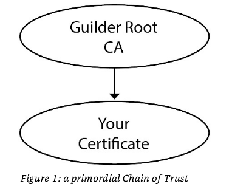
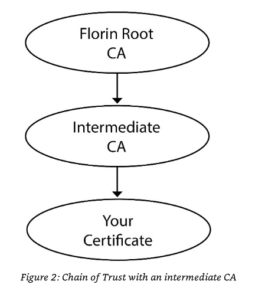
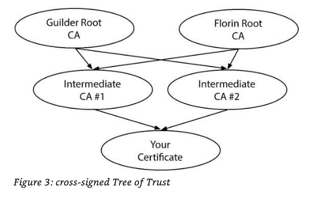

* Table Of Contents
  :PROPERTIES:
  :TOC:      :include all
  :END:
:CONTENTS:
- [[#table-of-contents][Table Of Contents]]
- [[#certificates][Certificates]]
- [[#certificate-standards][Certificate Standards]]
- [[#trust-anchors][Trust Anchors]]
  - [[#making-your-own-trust-bundle][Making your own Trust bundle]]
  - [[#the-openssl-trust-bundle][The OpenSSL Trust Bundle]]
- [[#certificate-components][Certificate Components]]
- [[#extensions-and-constraints][Extensions and Constraints]]
- [[#validation-levels][Validation Levels]]
- [[#trust-and-your-certificate][Trust and Your Certificate]]
  - [[#chain-of-trust][Chain of Trust]]
  - [[#intermediate-cas][Intermediate CAs]]
  - [[#tree-of-trust][Tree of Trust]]
- [[#certificate-validation][Certificate Validation]]
- [[#encoding][Encoding]]
  - [[#distinguished-encoding-rules-der][Distinguished Encoding Rules (DER)]]
  - [[#privacy-enhanced-mail-pem][Privacy Enhanced Mail (PEM)]]
  - [[#converting-between-encodings][Converting Between Encodings]]
  - [[#openssl-without-input-files][OpenSSL without input files]]
  - [[#pkcs-12][PKCS #12]]
  - [[#creating-a-pkcs-12-file][Creating a PKCS #12 file]]
  - [[#viewing-a-pkcs-12-file][Viewing a PKCS #12 File]]
  - [[#exporting-from-pkcs-12-file][Exporting from PKCS #12 File]]
- [[#certificate-contents][Certificate Contents]]
  - [[#certificate-extensions][Certificate Extensions]]
  - [[#certificate-transperencey][Certificate Transperencey]]
  - [[#digital-signature][Digital Signature]]
  - [[#skip-keys-and-signatures][Skip Keys and Signatures]]
  - [[#mutli-name-certificates][Mutli-Name Certificates]]
  - [[#wildcard-certificates][Wildcard certificates]]
- [[#viewing-remote-certficates][Viewing Remote Certficates]]
- [[#choosing-a-ca][Choosing a CA]]
:END:

* Certificates

- TLS is built on digital certificates. A digital certificate is a
  collection of carefully formatted information that identifies an
  entity, digitally signed by a Certificate Authority.
- A *server certificate* is intended for an application server, and is
  used to authoritatively identify the server. Most sysadmins focus on
  server certificates.
- A *client certificate* or *user certificate* identifies someone or
  something that authenticates to a server. An internal mail server
  might have a client certificate that authenticates it to its
  public-facing outbound mail server-the internal mail server is a
  client of the outbound server.
- A *trust anchor* sometimes called a *root certificate* is ultimately
  trusted to sign other certificates. Trust anchors might be globally
  trusted public CAs.
- *Issuing certificates* can sign other certificates.

* Certificate Standards

- TLS certificate information is organized as per X.509, the Internal
  Telecommunications Union's (ITU) standard for digital certificates.
- X.509 is built on Abstract Syntax Notation One (ASN.1), another ITU
  standard.
- ASN.1 is a method for defining cross platform data structures and
  providing information in a globally recognized manner.

* Trust Anchors

- A *trust anchor* often called a *root certificate* is included on a
  list of ultimately trusted certificates. Your system or application
  has been told to trust them, so it does.
- Every operating system or application platform provides a *trust
  bundle*, a collection of self-signed certificates trusted to sign
  other certificats. It might be also called as
  - *trust anchor bundle*
  - *root certificate bundle*
  - *certificate bundle*
  - *plan bundle*
- Vendors like Microsoft, Google maintain their own bundles. The
  Mozilla Foundation maintains the bundle used in Firefox, but most
  versions of Unix also use the Mozilla bundle or a derivative
  thereof.

** Making your own Trust bundle

- Many huge enterprise maintain their own trust bundle.

** The OpenSSL Trust Bundle

- OpenSSL must have a trust bundle to validate certificates.
- Most OpenSSL install use the Mozilla trust bundle.
- Most software expects to find certificates in */etc/ssl/certs*
- You can find the OpenSSL directory via *openssl version -a* command.

#+begin_src sh :exports both :eval never-export :results verbatim
openssl version -a
#+end_src

#+RESULTS:
: OpenSSL 1.1.1  11 Sep 2018
: built on: Mon Mar 22 11:42:42 2021 UTC
: platform: debian-amd64
: options:  bn(64,64) rc4(16x,int) des(int) blowfish(ptr)
: compiler: gcc -fPIC -pthread -m64 -Wa,--noexecstack -Wall -Wa,--noexecstack -g -O2 -fdebug-prefix-map=/build/openssl-nwsL4a/openssl-1.1.1=. -fstack-protector-strong -Wformat -Werror=format-security -DOPENSSL_USE_NODELETE -DL_ENDIAN -DOPENSSL_PIC -DOPENSSL_CPUID_OBJ -DOPENSSL_IA32_SSE2 -DOPENSSL_BN_ASM_MONT -DOPENSSL_BN_ASM_MONT5 -DOPENSSL_BN_ASM_GF2m -DSHA1_ASM -DSHA256_ASM -DSHA512_ASM -DKECCAK1600_ASM -DRC4_ASM -DMD5_ASM -DAES_ASM -DVPAES_ASM -DBSAES_ASM -DGHASH_ASM -DECP_NISTZ256_ASM -DX25519_ASM -DPADLOCK_ASM -DPOLY1305_ASM -DNDEBUG -Wdate-time -D_FORTIFY_SOURCE=2
: OPENSSLDIR: "/usr/lib/ssl"
: ENGINESDIR: "/usr/lib/x86_64-linux-gnu/engines-1.1"
: Seeding source: os-specific

So it seems to be on */user/lib/ssl* path:

#+begin_src sh :exports both :eval never-export :results verbatim
ls /usr/lib/ssl
#+end_src

#+RESULTS:
: certs
: misc
: openssl.cnf
: private

#+begin_src sh :exports both :eval never-export :results verbatim
ls /usr/lib/ssl/certs/ | head -n 3
#+end_src

#+RESULTS:
: 02265526.0
: 03179a64.0
: 062cdee6.0

#+begin_src sh :exports both :eval never-export :results verbatim
file /usr/lib/ssl/certs/02265526.0
#+end_src

#+RESULTS:
: /usr/lib/ssl/certs/02265526.0: symbolic link to Entrust_Root_Certification_Authority_-_G2.pem

#+begin_src sh :exports both :eval never-export :results verbatim
cat /usr/lib/ssl/certs/02265526.0
#+end_src

#+RESULTS:
#+begin_example
-----BEGIN CERTIFICATE-----
MIIEPjCCAyagAwIBAgIESlOMKDANBgkqhkiG9w0BAQsFADCBvjELMAkGA1UEBhMC
VVMxFjAUBgNVBAoTDUVudHJ1c3QsIEluYy4xKDAmBgNVBAsTH1NlZSB3d3cuZW50
cnVzdC5uZXQvbGVnYWwtdGVybXMxOTA3BgNVBAsTMChjKSAyMDA5IEVudHJ1c3Qs
IEluYy4gLSBmb3IgYXV0aG9yaXplZCB1c2Ugb25seTEyMDAGA1UEAxMpRW50cnVz
dCBSb290IENlcnRpZmljYXRpb24gQXV0aG9yaXR5IC0gRzIwHhcNMDkwNzA3MTcy
NTU0WhcNMzAxMjA3MTc1NTU0WjCBvjELMAkGA1UEBhMCVVMxFjAUBgNVBAoTDUVu
dHJ1c3QsIEluYy4xKDAmBgNVBAsTH1NlZSB3d3cuZW50cnVzdC5uZXQvbGVnYWwt
dGVybXMxOTA3BgNVBAsTMChjKSAyMDA5IEVudHJ1c3QsIEluYy4gLSBmb3IgYXV0
aG9yaXplZCB1c2Ugb25seTEyMDAGA1UEAxMpRW50cnVzdCBSb290IENlcnRpZmlj
YXRpb24gQXV0aG9yaXR5IC0gRzIwggEiMA0GCSqGSIb3DQEBAQUAA4IBDwAwggEK
AoIBAQC6hLZy254Ma+KZ6TABp3bqMriVQRrJ2mFOWHLP/vaCeb9zYQYKpSfYs1/T
RU4cctZOMvJyig/3gxnQaoCAAEUesMfnmr8SVycco2gvCoe9amsOXmXzHHfV1IWN
cCG0szLni6LVhjkCsbjSR87kyUnEO6fe+1R9V77w6G7CebI6C1XiUJgWMhNcL3hW
wcKUs/Ja5CeanyTXxuzQmyWC48zCxEXFjJd6BmsqEZ+pCm5IO2/b1BEZQvePB7/1
U1+cPvQXLOZprE4yTGJ36rfo5bs0vBmLrpxR57d+tVOxMyLlbc9wPBr64ptntoP0
jaWvYkxN4FisZDQSA/i2jZRjJKRxAgMBAAGjQjBAMA4GA1UdDwEB/wQEAwIBBjAP
BgNVHRMBAf8EBTADAQH/MB0GA1UdDgQWBBRqciZ60B7vfec7aVHUbI2fkBJmqzAN
BgkqhkiG9w0BAQsFAAOCAQEAeZ8dlsa2eT8ijYfThwMEYGprmi5ZiXMRrEPR9RP/
jTkrwPK9T3CMqS/qF8QLVJ7UG5aYMzyorWKiAHarWWluBh1+xLlEjZivEtRh2woZ
Rkfz6/djwUAFQKXSt/S1mja/qYh2iARVBCuch38aNzx+LaUa2NSJXsq9rD1s2G2v
1fN2D807iDginWyTmsQ9v4IbZT+mD12q/OWyFcq1rca8PdCE6OoGcrBNOTJ4vz4R
nAuknZoh8/CbCzB428Hch0P+vGOaysXCHMnHjf87ElgI5rY97HosTvuDls4MPGmH
VHOkc8KT/1EQrBVUAdj8BbGJoX90g5pJ19xOe4pIb4tF9g==
-----END CERTIFICATE-----
#+end_example

- Each Unix has their own way to manage these certificates. Eg:
  *certctl*, *add-trusted-cert* or *update-ca-certificates* or a
  tangle of OpenSSL commands.
- If you want to use a speficic CA certificate in an OpenSSL command,
  you can use the *-CAfile* option.

* Certificate Components

- Certificate contains two primary pieces:
  - Information about the entity being certified
  - Digital signature of that information
- The information about the entity being certified is created by the
  entity requesting the certificate.
- The certificate also includes a public key.
- The organization information and the public key is gathered together
  into an X.509 formatted file called a certificate signing request or
  CSR.
- You submit the certificate signing request to your Certificate
  Authority.
- The CA verifies the information in the certificate signing
  request. Once the CA is satisfied of the request's legitimacy it
  attaches any delegated permissions and digitally signs the whole
  thing. That's the certificate.
- Certificates have validaty dates. Latest browsers reject
  certificates older than 398 days.
- Using a certificate requires the certificate file returned from the
  CA, plus the private key created when you made the certificate
  signing request. The certificate is useless without both components.

* Extensions and Constraints

- While the certificate's X.509 format rigidly defines data fields, it
  is also extensible. A certificate issuer can add their own rigidly
  defined data fields to certificates.
- Most of these extensions are used as constraints or policy
  statements.
- A constraint dictates how the certificate can be used. One common
  constraint is a name constraint, where the certificate can sign
  other certificates within a certain domain.
- A policy most often appplies to aspects of the TLS connection. Most
  policies are built with X.509 extensions.

* Validation Levels

- Certain environments might require server certificates with greater
  level of trust than usual.
- A domain validated (DV) certificate means that the CA verified that
  the requesting entity owns and controls the domain the certificate
  is for. All free ACME and most inexpensive certs are DV.
- An organization validated (OV) ceretificate includes everything in a
  DV certificate but also checks that the requesting organization
  exists and is at the address claimed. Most commercial CAs offer OV
  certificates.
- An extended validated (EV) certificate digs into the entity
  requesting the certificate. It verifies the organization's business
  registration and jurisdiction.

* Trust and Your Certificate

- The whole point of a certificate is for an entity to prove its
  identity. Historically, certificate were validated using a Chain of
  Trust. Today, it's more like a Tree of Trust.

** Chain of Trust

- Back in the day, a sysadmin issued a Certificate Signing Request
  containing their organization and server information. A CSR was
  basically a certificate without the digital signature. The sysadmin
  sent the request to a CA, along with a wad of cash. The CA signed
  the CSR creating a complete certificate and returned it to the
  sysadmin, who installed the certificate file on their server.

** Intermediate CAs

- Root CAs operate under very strict requirements. Root CAs are busy
  and that why intermediate CAs come in.
- An intermediate CA has a certificate signed by a trusted CA, so
  clients will trust it in turn. The intermediate CA certificate has
  been delegated the privilege of signing further certificates.
- You now have a Chain of Trust with multiple links, like a real
  chain.
- Clients visiting your web site validate your certificate by
  evaulating the signature on your certificate and then the signature
  on the certificate used to sign your cert, then the CA's
  certificate. If eveything matched, your certificate is valid.
- One complication with Chains of Trust is that the client only has
  the trust anchor. It does not have the intermediate certificats, nor
  any way of collecting them. Without these, validation fails. The
  server must offer the client the *certificate chain*. A *chain file*
  also called as a *CA bundle* includes any and all intermediate
  certificates.

** Tree of Trust

- Cross-signing permists certificates to carry more than one
  signature. So long as the client can find one chain of valid
  signatures leading to a trusted root, the client trust the
  certificate. Cross-signing creates something like things:

- Advantages:
  - If an intermediate CA's certificate is revoked, the other CA
    provides valid links to a root CA.
  - You could lose all but one trusted entitity on each level and
    still validate the ceritifcate.

* Certificate Validation

- Clients must validate server certificates.
- Some applications require the client provide a certificate to the
  server.
- Upon making the TLS connection, the server presents its certificate
  and any intermediate certificates to the client. The client inspects
  those certificates, checking both the validity dates and the digital
  signatures.

* Encoding

- While certificates all use the X.509 format, a system can encode and
  store those certificates in many ways.
- Various extensions present: .pem, .der, .crt and more.

** Distinguished Encoding Rules (DER)

- The Distinguished Encoding Rules (DER) is one of the oldest methods
  of encoding X.509 certificates.
- The file command indicates that it is "data". The only way to be
  sure if a file is DER-encoded is vai this:

#+begin_example
openssl x509 -in file.der -inform der -text -noout
#+end_example

- *-in* option lets you specify a file to be read.
- *-inform* option denotes incoming format.
- *-text* flag tells OpenSSL to provide the output in human readable
  text form.
- *-noout* prevents display of the encoded certificate.

** Privacy Enhanced Mail (PEM)

- The IETF created a standard for sending encrypted email, Privacy
  Enhanced Email (PEM) in 1993.
- PEM is mostly base64-encoded DER, plus headers and footers to make
  it more human friendly.
- Files containing PEM-encoded items often end in *.pem* but you'll
  also see *.crt* for files containing a certificate or *.key* for
  public or private keys. The nice thing about PEM encoding is that
  you can read the headers and see what's in it.
- OpenSSL command to view PEM-encoded certificate:

#+begin_example
openssl x509 -in file.crt -noout -text
#+end_example

- OpenSSL defaults to PEM so there's no need to manually set *-inform*.

** Converting Between Encodings

- Re-encoding uses the *-in* option we used to view certificates. It
  also needs *-out* to give a destination filename.
- It also uses the *-inform* and *-outform* to tell OpenSSL how to
  read DER files and what encodings to use.
- Converting DER to PEM:

#+begin_example
openssl x509 -in www.der -inform der -outform pem -out www.pem
#+end_example

- Converting PEM to DER:

#+begin_example
openssl x509 -in www.crt -outform der -out www.der
#+end_example

** OpenSSL without input files

- If you don't specify an input source with *-in* or |, OpenSSL takes
  input from standard input.

** PKCS #12

- The Public Key Cryptography Standards (PKCS) from RSA Laboratories
  defines methods for storing, arranging, and using cryptographic
  information.
- PKCS #10 defines CSRs.
- PKCS #12 defines how to store multiple related encryption files in a
  single archive file.
- PKCS #12 is most commonly used to store certificate chain and its
  private key.
- It usually has a suffix of pfx or p12.

** Creating a PKCS #12 file

- Inputs
  - Private key: privkey.pem
  - Certificate: cert.pem
  - Chain File: chain.pem
- OpenSSL options
  - *-out* flag lets you set the name of PKCS #12 archive file.
  - *-inkey* to give the private key
  - *-in* for the certificate file
  - *-certfile* for additional certificate files

#+begin_example
openssl pkcs12 -export -out site.p12 -inkey privkey.pem -in cert.pem -certfile chain.pem
#+end_example

** Viewing a PKCS #12 File

#+begin_example
openssl pkcs12 -info -in site.p12
#+end_example

Adding *-nodes* flag will let you see the private key unencrypted.

** Exporting from PKCS #12 File

#+begin_example
openssl pkcs12 -in site.p12 -out all.crt -nodes
#+end_example

- Adding *-nodes* flag will leave the the private key unencrypted.
- You probably don't want the certificate and key in a single
  file. You probably want the certificate in one file and the private
  key in another:

#+begin_example
openssl pkcs12 -in site.p12 -out certs.crt -nokeys
#+end_example

- Use *-nokeys* to skip the private key.
- Use *-nocerts* to extract only the private key:

#+begin_example
openssl pkcs12 -in site.p12 -nodes -out private.key -nocerts
#+end_example

* Certificate Contents

#+begin_src sh :exports both :eval never-export :results verbatim
openssl x509 -in /usr/lib/ssl/certs/02265526.0 -text -noout
#+end_src

#+RESULTS:
#+begin_example
Certificate:
    Data:
        Version: 3 (0x2)
        Serial Number: 1246989352 (0x4a538c28)
        Signature Algorithm: sha256WithRSAEncryption
        Issuer: C = US, O = "Entrust, Inc.", OU = See www.entrust.net/legal-terms, OU = "(c) 2009 Entrust, Inc. - for authorized use only", CN = Entrust Root Certification Authority - G2
        Validity
            Not Before: Jul  7 17:25:54 2009 GMT
            Not After : Dec  7 17:55:54 2030 GMT
        Subject: C = US, O = "Entrust, Inc.", OU = See www.entrust.net/legal-terms, OU = "(c) 2009 Entrust, Inc. - for authorized use only", CN = Entrust Root Certification Authority - G2
        Subject Public Key Info:
            Public Key Algorithm: rsaEncryption
                RSA Public-Key: (2048 bit)
                Modulus:
                    00:ba:84:b6:72:db:9e:0c:6b:e2:99:e9:30:01:a7:
                    76:ea:32:b8:95:41:1a:c9:da:61:4e:58:72:cf:fe:
                    f6:82:79:bf:73:61:06:0a:a5:27:d8:b3:5f:d3:45:
                    4e:1c:72:d6:4e:32:f2:72:8a:0f:f7:83:19:d0:6a:
                    80:80:00:45:1e:b0:c7:e7:9a:bf:12:57:27:1c:a3:
                    68:2f:0a:87:bd:6a:6b:0e:5e:65:f3:1c:77:d5:d4:
                    85:8d:70:21:b4:b3:32:e7:8b:a2:d5:86:39:02:b1:
                    b8:d2:47:ce:e4:c9:49:c4:3b:a7:de:fb:54:7d:57:
                    be:f0:e8:6e:c2:79:b2:3a:0b:55:e2:50:98:16:32:
                    13:5c:2f:78:56:c1:c2:94:b3:f2:5a:e4:27:9a:9f:
                    24:d7:c6:ec:d0:9b:25:82:e3:cc:c2:c4:45:c5:8c:
                    97:7a:06:6b:2a:11:9f:a9:0a:6e:48:3b:6f:db:d4:
                    11:19:42:f7:8f:07:bf:f5:53:5f:9c:3e:f4:17:2c:
                    e6:69:ac:4e:32:4c:62:77:ea:b7:e8:e5:bb:34:bc:
                    19:8b:ae:9c:51:e7:b7:7e:b5:53:b1:33:22:e5:6d:
                    cf:70:3c:1a:fa:e2:9b:67:b6:83:f4:8d:a5:af:62:
                    4c:4d:e0:58:ac:64:34:12:03:f8:b6:8d:94:63:24:
                    a4:71
                Exponent: 65537 (0x10001)
        X509v3 extensions:
            X509v3 Key Usage: critical
                Certificate Sign, CRL Sign
            X509v3 Basic Constraints: critical
                CA:TRUE
            X509v3 Subject Key Identifier:
                6A:72:26:7A:D0:1E:EF:7D:E7:3B:69:51:D4:6C:8D:9F:90:12:66:AB
    Signature Algorithm: sha256WithRSAEncryption
         79:9f:1d:96:c6:b6:79:3f:22:8d:87:d3:87:03:04:60:6a:6b:
         9a:2e:59:89:73:11:ac:43:d1:f5:13:ff:8d:39:2b:c0:f2:bd:
         4f:70:8c:a9:2f:ea:17:c4:0b:54:9e:d4:1b:96:98:33:3c:a8:
         ad:62:a2:00:76:ab:59:69:6e:06:1d:7e:c4:b9:44:8d:98:af:
         12:d4:61:db:0a:19:46:47:f3:eb:f7:63:c1:40:05:40:a5:d2:
         b7:f4:b5:9a:36:bf:a9:88:76:88:04:55:04:2b:9c:87:7f:1a:
         37:3c:7e:2d:a5:1a:d8:d4:89:5e:ca:bd:ac:3d:6c:d8:6d:af:
         d5:f3:76:0f:cd:3b:88:38:22:9d:6c:93:9a:c4:3d:bf:82:1b:
         65:3f:a6:0f:5d:aa:fc:e5:b2:15:ca:b5:ad:c6:bc:3d:d0:84:
         e8:ea:06:72:b0:4d:39:32:78:bf:3e:11:9c:0b:a4:9d:9a:21:
         f3:f0:9b:0b:30:78:db:c1:dc:87:43:fe:bc:63:9a:ca:c5:c2:
         1c:c9:c7:8d:ff:3b:12:58:08:e6:b6:3d:ec:7a:2c:4e:fb:83:
         96:ce:0c:3c:69:87:54:73:a4:73:c2:93:ff:51:10:ac:15:54:
         01:d8:fc:05:b1:89:a1:7f:74:83:9a:49:d7:dc:4e:7b:8a:48:
         6f:8b:45:f6
#+end_example

- Version gives the X.509 certificate version of this
  certificate. Version 3 is the most common for TLS certificates.
- The serial number uniquely identifies this certificate among all the
  certificates signed by this CA. If you need to revoke a certificate,
  you might need this number.
- Signature alorithm tells how the CA signed this certificate.
- The Issuer identifies the CA. The information given here is in X.509
  format.
  - C gives the country
  - O gives the organization
  - CN label gives the Common Name for this entity.
- Validity gives timestamps for when this certificate becomes valid
  and when it expires.
- The Subject is the primary identity of the entity being
  certifified. It is often called the Distinguished Name.
- The Subject Public Key Info provides the details of my host's public
  key. This is not the CA's key, but the public key generated on my
  host when I requested a certificate.
- The Public key Algorithm identifies the algorithm used and the bit size.
- The /modulus/ and the /exponent/ are the public key's numerical components.

** Certificate Extensions

#+begin_src sh :exports both :eval never-export :results verbatim
openssl s_client -connect psibi.in:443 | openssl x509 -text -noout
#+end_src

#+RESULTS:
#+begin_example
Certificate:
    Data:
        Version: 3 (0x2)
        Serial Number:
            03:cc:e7:17:ac:b2:12:26:04:a4:f2:c8:86:dc:02:89:c8:50
        Signature Algorithm: sha256WithRSAEncryption
        Issuer: C = US, O = Let's Encrypt, CN = R3
        Validity
            Not Before: Mar 24 03:59:18 2021 GMT
            Not After : Jun 22 03:59:18 2021 GMT
        Subject: CN = psibi.in
        Subject Public Key Info:
            Public Key Algorithm: rsaEncryption
                RSA Public-Key: (2048 bit)
                Modulus:
                    00:ab:c7:1b:0c:ed:c6:01:f8:ea:a9:b3:cf:08:17:
                    4f:a2:cb:7c:34:c4:66:12:e6:ef:f3:98:17:79:c9:
                    65:ee:66:4c:1f:9a:92:7d:33:ee:07:fa:2e:15:62:
                    f7:b4:f3:1f:d5:4f:2e:b1:67:a8:49:42:bf:e3:cc:
                    9a:b7:30:46:c2:68:f5:28:a9:64:69:6f:4c:4b:64:
                    24:c9:dc:ed:46:9f:a4:1f:c2:ef:6f:36:d0:bc:69:
                    27:b8:e2:d6:18:70:40:2c:b4:f5:ee:8f:f7:0d:8c:
                    6e:03:92:e7:5d:d6:3e:bc:bb:c9:5b:28:10:a0:5a:
                    f6:37:f5:e1:9e:15:23:72:6e:8e:69:01:09:a4:8c:
                    a4:c9:d7:db:05:01:90:48:4b:90:20:8c:38:7a:0a:
                    60:74:79:18:26:30:8e:60:0b:17:b9:24:a0:80:df:
                    3f:14:00:d3:09:e7:34:47:35:63:7c:54:d2:a0:9d:
                    e1:57:d1:cb:13:d3:3c:30:24:97:8e:ea:34:00:9f:
                    cc:6c:0c:6a:f7:54:bc:5e:60:dc:46:31:c2:09:de:
                    d9:c3:e3:63:1e:8f:1c:c5:90:90:e8:da:86:be:7d:
                    f1:c3:1f:1a:86:69:9b:0b:e0:b2:0c:47:08:c8:92:
                    59:2b:66:2f:fa:a1:38:a1:2f:10:65:f6:97:fd:16:
                    87:33
                Exponent: 65537 (0x10001)
        X509v3 extensions:
            X509v3 Key Usage: critical
                Digital Signature, Key Encipherment
            X509v3 Extended Key Usage:
                TLS Web Server Authentication, TLS Web Client Authentication
            X509v3 Basic Constraints: critical
                CA:FALSE
            X509v3 Subject Key Identifier:
                63:4E:15:85:56:5A:A4:94:02:C2:16:42:A4:A5:97:9A:38:02:57:97
            X509v3 Authority Key Identifier:
                keyid:14:2E:B3:17:B7:58:56:CB:AE:50:09:40:E6:1F:AF:9D:8B:14:C2:C6

            Authority Information Access:
                OCSP - URI:http://r3.o.lencr.org
                CA Issuers - URI:http://r3.i.lencr.org/

            X509v3 Subject Alternative Name:
                DNS:psibi.in
            X509v3 Certificate Policies:
                Policy: 2.23.140.1.2.1
                Policy: 1.3.6.1.4.1.44947.1.1.1
                  CPS: http://cps.letsencrypt.org

            CT Precertificate SCTs:
                Signed Certificate Timestamp:
                    Version   : v1 (0x0)
                    Log ID    : 94:20:BC:1E:8E:D5:8D:6C:88:73:1F:82:8B:22:2C:0D:
                                D1:DA:4D:5E:6C:4F:94:3D:61:DB:4E:2F:58:4D:A2:C2
                    Timestamp : Mar 24 04:59:18.777 2021 GMT
                    Extensions: none
                    Signature : ecdsa-with-SHA256
                                30:45:02:20:2B:8A:72:22:CE:56:D6:C9:43:35:3B:5B:
                                5B:81:12:7C:3E:F0:3B:E1:66:68:26:C8:67:29:9B:92:
                                01:36:B7:0E:02:21:00:A8:7A:66:AD:5D:0F:6A:F2:28:
                                AB:9D:16:8F:DA:EF:9E:35:FA:94:51:B7:32:2C:7B:57:
                                84:0C:02:0F:0B:3B:4C
                Signed Certificate Timestamp:
                    Version   : v1 (0x0)
                    Log ID    : 7D:3E:F2:F8:8F:FF:88:55:68:24:C2:C0:CA:9E:52:89:
                                79:2B:C5:0E:78:09:7F:2E:6A:97:68:99:7E:22:F0:D7
                    Timestamp : Mar 24 04:59:18.834 2021 GMT
                    Extensions: none
                    Signature : ecdsa-with-SHA256
                                30:44:02:20:43:3E:F8:39:F4:40:20:20:7D:DE:32:D7:
                                15:64:1B:A8:C0:56:CE:A1:A0:29:06:5A:CA:38:E4:D3:
                                5B:89:A9:5B:02:20:20:24:98:76:68:60:80:9B:10:CF:
                                5B:31:80:F2:50:15:0F:40:64:98:7F:65:6E:10:CC:BC:
                                5B:2E:8D:DE:7D:D5
    Signature Algorithm: sha256WithRSAEncryption
         b6:07:2d:13:2c:39:4f:78:ff:9f:5c:3b:eb:88:44:ee:df:d9:
         88:42:eb:e3:ea:aa:d1:6e:21:7b:24:58:f9:38:9e:f1:53:f5:
         30:34:b8:73:5a:23:9d:c3:4c:0d:2a:67:d2:6d:15:e5:a3:38:
         57:d9:87:b9:8e:0f:5c:2a:98:15:f2:bb:a4:86:bb:ba:fc:71:
         41:ec:09:f3:6d:06:ff:f1:f7:d4:40:d8:2b:84:c9:95:b4:d9:
         c1:d2:e6:7e:1e:7b:70:7d:81:51:86:03:b3:fe:e6:8d:60:40:
         10:a7:c5:f0:29:10:25:2d:99:e2:99:e5:5c:8a:f0:87:ff:55:
         95:7b:36:aa:bb:7c:bc:bd:44:85:47:94:fd:18:03:47:7e:db:
         0e:3c:9d:83:18:1f:b2:04:66:66:87:c1:1c:39:77:9e:5c:71:
         37:8f:97:3a:0b:b1:f1:e0:e6:f5:b0:60:16:08:7f:bb:32:c5:
         4a:e2:0d:05:f7:1a:df:b3:90:07:f5:71:51:18:3b:3f:8f:1a:
         62:db:41:45:be:a4:eb:f7:69:42:b4:dd:3d:dc:b1:d2:01:bb:
         6e:c1:85:68:96:3b:b5:59:9e:b5:54:91:c4:c3:83:84:fa:40:
         f9:26:e4:11:73:30:d5:28:ad:7b:9f:c4:77:17:5a:53:ef:95:
         db:ae:5f:c0
#+end_example

- The *x509v3 Key Usage extension* declares how this certificate can be used
  for low-level TLS and encryption options.
- The *x509v3 Extended Key Usage* extension gives a higher level view
  of how the certificate can be used. This extension isn't usually
  critical, so applicationss are free to ignore it if they wish.
- The *x509v3 Basic Constraints* extension identifies if this
  certificate is a Certificate Authority root certificate. If CA is
  false, this certificate can't sign other certificates. If it's True,
  it's a CA certificate. This extension is critical and must be obeyed.
- The *x509v3 Key Identifier* are public keys.
- The *x509v3 Authority Key Identifier* is the signer's public key.
- The *Authority Information* extension declares how the CA offers
  further information about this certificate.
- The *x509v3 Subject Alternative Name* field lists all the valid host
  names. A certificate can be valid for multiple hosts. This replaces
  the Common Name.
- The *x509v3 Certificate Policies* extension descirbes the CA's
  organization, operation controls, and procedures. You can get more
  information at the Certificate Practice Statement (CPS) site shown.
- You can get a particular extension like this:

#+begin_src sh :exports both :eval never-export :results verbatim
echo "Q" | openssl s_client -connect psibi.in:443 | openssl x509 -noout -ext keyUsage
#+end_src

#+RESULTS:
: X509v3 Key Usage: critical
:     Digital Signature, Key Encipherment

- You can get more help from x509v3_config. (man 5 x509v3_config)

** Certificate Transperencey

- Certificates are public information. You can look up all the
  certificats issued for a domain.
- The *Signed Certificate Timestamp* (SCT) provides cryptographic
  proof that the certificate was submitted to a certificate log.
- Eventually TLS clients will reject certificats ahat were not
  submitted to a public log.

** Digital Signature

At the end of the certificate, you'll see the digital signature.

** Skip Keys and Signatures

#+begin_src sh :exports both :eval never-export :results verbatim
echo "Q" | openssl s_client -connect psibi.in:443 | openssl x509 -text -noout -certopt no_pubkey,no_sigdump
#+end_src

#+RESULTS:
#+begin_example
Certificate:
    Data:
        Version: 3 (0x2)
        Serial Number:
            03:cc:e7:17:ac:b2:12:26:04:a4:f2:c8:86:dc:02:89:c8:50
        Signature Algorithm: sha256WithRSAEncryption
        Issuer: C = US, O = Let's Encrypt, CN = R3
        Validity
            Not Before: Mar 24 03:59:18 2021 GMT
            Not After : Jun 22 03:59:18 2021 GMT
        Subject: CN = psibi.in
        X509v3 extensions:
            X509v3 Key Usage: critical
                Digital Signature, Key Encipherment
            X509v3 Extended Key Usage:
                TLS Web Server Authentication, TLS Web Client Authentication
            X509v3 Basic Constraints: critical
                CA:FALSE
            X509v3 Subject Key Identifier:
                63:4E:15:85:56:5A:A4:94:02:C2:16:42:A4:A5:97:9A:38:02:57:97
            X509v3 Authority Key Identifier:
                keyid:14:2E:B3:17:B7:58:56:CB:AE:50:09:40:E6:1F:AF:9D:8B:14:C2:C6

            Authority Information Access:
                OCSP - URI:http://r3.o.lencr.org
                CA Issuers - URI:http://r3.i.lencr.org/

            X509v3 Subject Alternative Name:
                DNS:psibi.in
            X509v3 Certificate Policies:
                Policy: 2.23.140.1.2.1
                Policy: 1.3.6.1.4.1.44947.1.1.1
                  CPS: http://cps.letsencrypt.org

            CT Precertificate SCTs:
                Signed Certificate Timestamp:
                    Version   : v1 (0x0)
                    Log ID    : 94:20:BC:1E:8E:D5:8D:6C:88:73:1F:82:8B:22:2C:0D:
                                D1:DA:4D:5E:6C:4F:94:3D:61:DB:4E:2F:58:4D:A2:C2
                    Timestamp : Mar 24 04:59:18.777 2021 GMT
                    Extensions: none
                    Signature : ecdsa-with-SHA256
                                30:45:02:20:2B:8A:72:22:CE:56:D6:C9:43:35:3B:5B:
                                5B:81:12:7C:3E:F0:3B:E1:66:68:26:C8:67:29:9B:92:
                                01:36:B7:0E:02:21:00:A8:7A:66:AD:5D:0F:6A:F2:28:
                                AB:9D:16:8F:DA:EF:9E:35:FA:94:51:B7:32:2C:7B:57:
                                84:0C:02:0F:0B:3B:4C
                Signed Certificate Timestamp:
                    Version   : v1 (0x0)
                    Log ID    : 7D:3E:F2:F8:8F:FF:88:55:68:24:C2:C0:CA:9E:52:89:
                                79:2B:C5:0E:78:09:7F:2E:6A:97:68:99:7E:22:F0:D7
                    Timestamp : Mar 24 04:59:18.834 2021 GMT
                    Extensions: none
                    Signature : ecdsa-with-SHA256
                                30:44:02:20:43:3E:F8:39:F4:40:20:20:7D:DE:32:D7:
                                15:64:1B:A8:C0:56:CE:A1:A0:29:06:5A:CA:38:E4:D3:
                                5B:89:A9:5B:02:20:20:24:98:76:68:60:80:9B:10:CF:
                                5B:31:80:F2:50:15:0F:40:64:98:7F:65:6E:10:CC:BC:
                                5B:2E:8D:DE:7D:D5
#+end_example

- The *-certopt* flag allows you to skip certain fields.

** Mutli-Name Certificates

- If my site is at psibi.in, and if someone wants to go via
  www.psibi.in - You would want that workflow to work.
- A modern TLS certificate uses Subject Alternative Names or SANs to
  identify all of the hostsnames the certificate is good for.

#+begin_src sh :exports both :eval never-export :results verbatim
echo "Q" | openssl s_client -connect psibi.in:443 | openssl x509 -noout -ext subjectAltName
#+end_src

#+RESULTS:
: X509v3 Subject Alternative Name:
:     DNS:psibi.in

- It seems there is no certificate for me for www.psibi.in. I need to
  get that fixed!

** Wildcard certificates

- I can also get a certificate like /*psibi.in/ as a Subject
  Alternative Name.
- Cons:
  - If the private key is stolen, you are screwed.

* Viewing Remote Certficates

- You can see examples from above.
- If you want to write the certificte to file, use the *-out* option.

#+begin_src sh :exports both :eval never-export :results verbatim
echo "Q" | openssl s_client -connect psibi.in:443 | openssl x509 -out sibi.pem
#+end_src

#+begin_src sh :exports both :eval never-export :results verbatim
cat sibi.pem | head -n 3
#+end_src

#+RESULTS:
: -----BEGIN CERTIFICATE-----
: MIIFFTCCA/2gAwIBAgISA8znF6yyEiYEpPLIhtwCichQMA0GCSqGSIb3DQEBCwUA
: MDIxCzAJBgNVBAYTAlVTMRYwFAYDVQQKEw1MZXQncyBFbmNyeXB0MQswCQYDVQQD

- To view all the certificates in the Chain of Trust, use the
  *-showcerts* option of *s_client*. The x509 subcommand won't parse
  all of these certificates simultaneously, so you'll need to save
  this to a file and analyze them separately.
- Dowloading chain file:

#+begin_src sh :exports both :eval never-export :results verbatim
openssl s_client -showcerts -connect psibi.in:443 > sibi.chain
#+end_src

- You would need to cut the certificates into separate PEM-encoded
  files from sibi.chain in the above command.

* Choosing a CA

- You must use a CA included in the major trust bundles.
